# DEMUCS Audio Denoising

Speech denoising with a DEMUCS-style neural network that works directly on raw waveforms. This repo has the trained weights, the model code, and a small Streamlit app where you can upload a noisy WAV file and listen to the cleaned version.

It's the deep learning half of our final-year project, **"Traditional Filters and AI for Enhanced Signal De-noising"** (Tribhuvan University, IOE Pulchowk Campus, April 2025). The project compared classic DSP denoising methods against a DEMUCS model on the same kind of noisy speech.

This is a student project, and it hasn't been published as a paper. The numbers below come straight from our project report, and we've tried to be upfront about where the model works and where it doesn't.

---

## What's in this repo

```
DEMUCS-Audio-Denoising/
├── denoise.py          # model definition, inference code and the Streamlit app
├── epoch_75.pth        # trained weights (75 epochs)
├── requirements.txt    # Python dependencies
├── assets/             # figures used in this README
└── README.md
```

What's **not** here: the training notebook (we trained in Google Colab and didn't keep it in this repo), the dataset, and the code for the traditional filters. Everything about training in this README is taken from the project report.

---

## How the model works

The idea is simple. Noisy waveform goes in, cleaned waveform comes out. There's no spectrogram step in the middle. The network squeezes the audio down into a compact representation, uses an LSTM to make sense of it over time, then expands it back into a waveform.

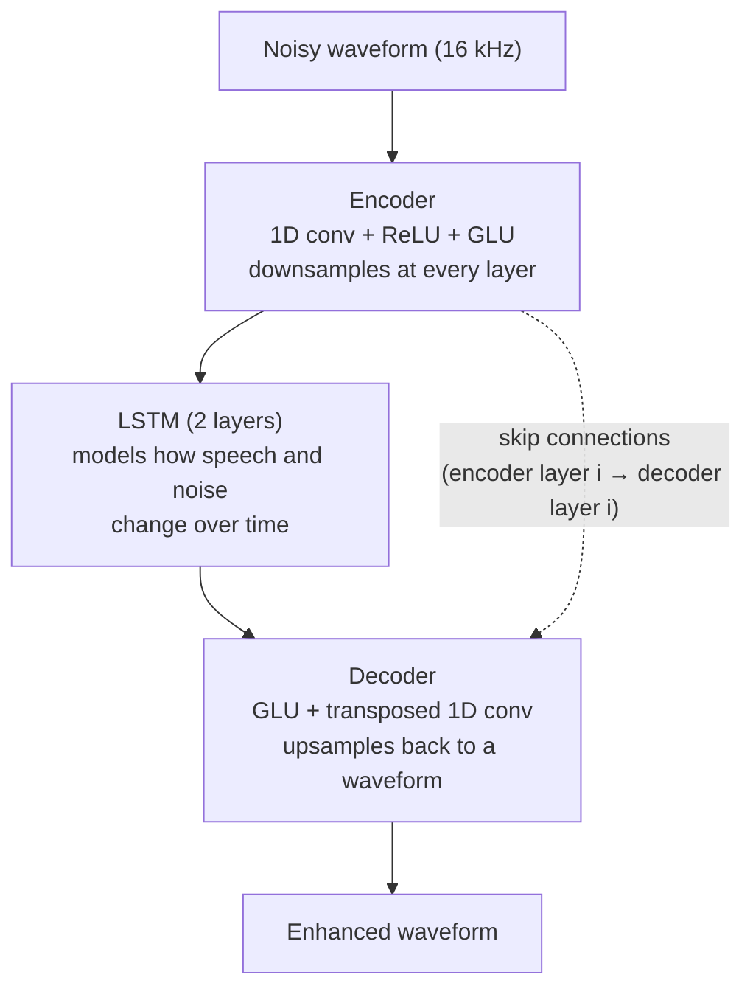

### The three parts

**Encoder.** A stack of 1D convolution layers. Each one shrinks the signal in time and adds more feature channels, so the audio gets squeezed into a smaller but richer representation. Each layer uses ReLU and a Gated Linear Unit (GLU), and the GLU decides how much of each feature gets passed on.

**LSTM.** Speech has structure over time and noise usually doesn't follow the same pattern. The LSTM sits between the encoder and decoder and looks at the whole compressed sequence to help tell the two apart. The report also describes this stage with a residual connection: `ẑ = LSTM(z) + z`.

**Decoder.** Mirrors the encoder using transposed convolutions to bring the signal back up to full length. Skip connections copy features from each encoder layer straight across to the matching decoder layer, so fine details lost while downsampling can be recovered.

### Diagrams from the report

The full network, with `H` as the number of channels and `L` as the depth. Arrows on the left are the skip connections:

<p align="center">
  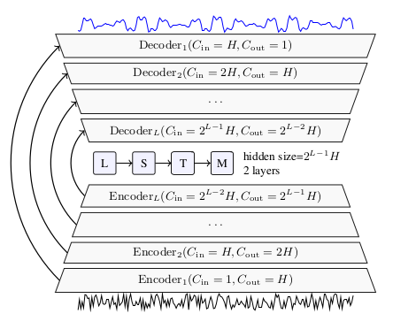
</p>

What a single encoder block (bottom) and decoder block (top) look like inside:

<p align="center">
  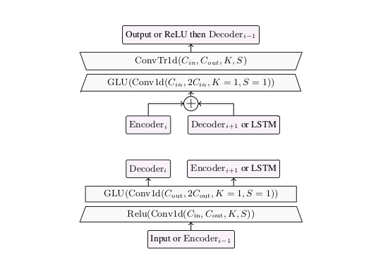
</p>

The architecture follows the DEMUCS speech enhancement model from Défossez, Synnaeve and Adi, *Real Time Speech Enhancement in the Waveform Domain* (Facebook AI Research). We trained our own version on our own data.

### Model settings

| Setting | Value |
|---|---|
| Input | Raw waveform, 16 kHz |
| Encoder depth | 5 layers |
| Base channels (H) | 48 |
| Kernel size / stride | 8 / 4 |
| Sequence model | LSTM, 2 layers, unidirectional |
| Activations | ReLU and GLU |
| Segment length | 1 second |
| Checkpoint | `epoch_75.pth` |

---

## Training

| | |
|---|---|
| Dataset | Valentini-Botinhao (paired clean and noisy speech) |
| Training samples | 34,347 |
| Test samples | 824 |
| Preprocessing | Resampled to 16 kHz, amplitude normalised, split into 1-second clips (no overlap) |
| Epochs | 75 |
| Batch size | 64 |
| Optimizer | Adam (β1 = 0.9, β2 = 0.999, ε = 1e-8) |
| Learning rate | Started at 1e-4. The report says it was raised to 1e-3 after epoch 55 and to 1.5e-3 after epoch 65 |
| Regularisation | Small weight decay, gradient clipping (mainly for the LSTM) |
| Loss | L1 waveform loss + multi-resolution STFT loss |
| Hardware | Google Colab CPU runtime (Intel Xeon, 2 vCPUs, 13 GB RAM) |

During training we tracked the average of the two loss terms, not PESQ or STOI. The model was trained once and we didn't do any tuning runs on top of it.

### Loss values

| Epoch | Training loss | Validation loss |
|---|---|---|
| 1 | 2.848 | 2.151 |
| 55 | 1.598 | 1.597 |
| 75 | 1.443 | 1.436 |

Training and validation loss stay close together, so there's no sign of heavy overfitting.

<p align="center">
  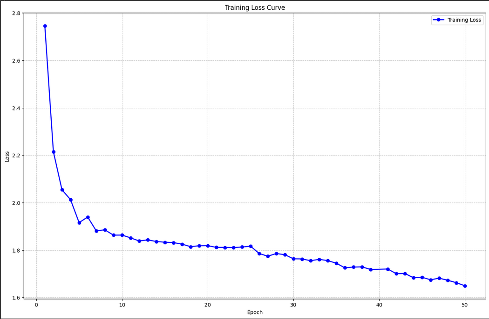
</p>
<p align="center"><sub>Training loss, epochs 1 to 50.</sub></p>

<p align="center">
  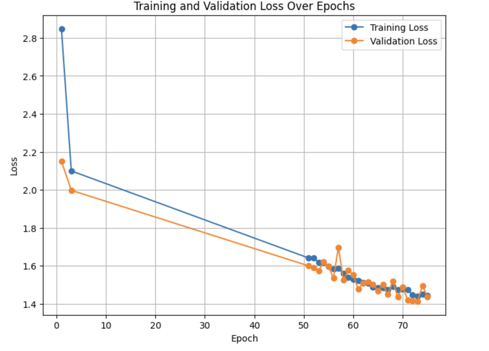
</p>
<p align="center"><sub>Training vs. validation loss. We only logged some of the epochs, so the straight line between epoch 3 and epoch 51 is just the plot joining two points. It's not real data.</sub></p>

---

## Results

Everything in this section comes from the project report. The charts are redrawn from the report's numbers (PESQ, STOI and SNR are the usual speech-quality measures: higher is better for all three).

### Listen to it

Three versions of each example: the clean reference, the noisy input, and the DEMUCS output. These are the same two samples used for the waveform plots below.

| Example | Clean | Noisy | Enhanced (DEMUCS) |
|---|---|---|---|
| Sample 1 (~1.5 s) | [clean](samples/sample1_clean.wav) | [noisy](samples/sample1_noisy.wav) | [enhanced](samples/sample1_enhanced.wav) |
| Sample 2 (~6 s) | [clean](samples/sample2_clean.wav) | [noisy](samples/sample2_noisy.wav) | [enhanced](samples/sample2_enhanced.wav) |

GitHub can't play audio inside a README, so click a file and use the player on its page, or download it.

### Waveforms

Top: clean reference. Middle: noisy input. Bottom: DEMUCS output.

**Sample 1 (about 1.5 s)**

<p align="center">
  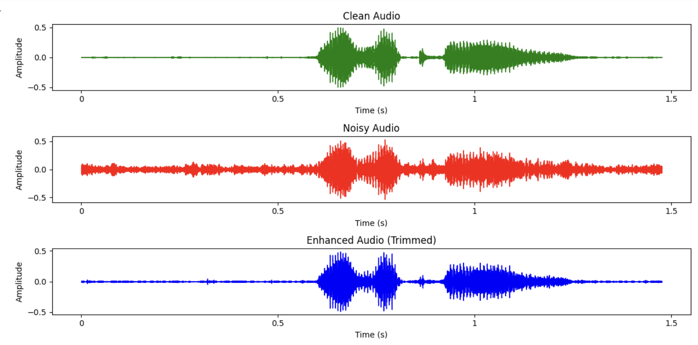
</p>

**Sample 2 (about 6 s)**

<p align="center">
  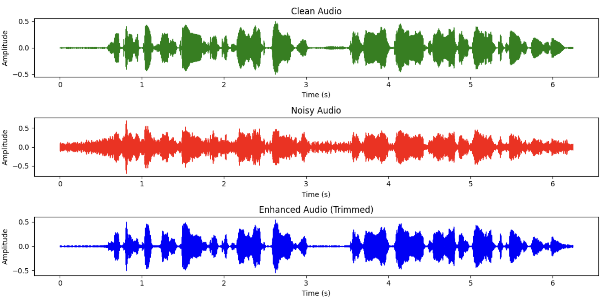
</p>

In both samples the quiet stretches, where the noisy input is just hiss, come out almost flat, and the speech bursts line up closely with the clean version.

### Test-set performance

| Metric | Noisy | Enhanced | Change |
|---|---|---|---|
| PESQ | 1.967 | 2.001 | +0.034 |
| STOI | 0.921 | 0.888 | −0.033 |
| SNR | | | +3.940 dB (average improvement) |

<p align="center">
  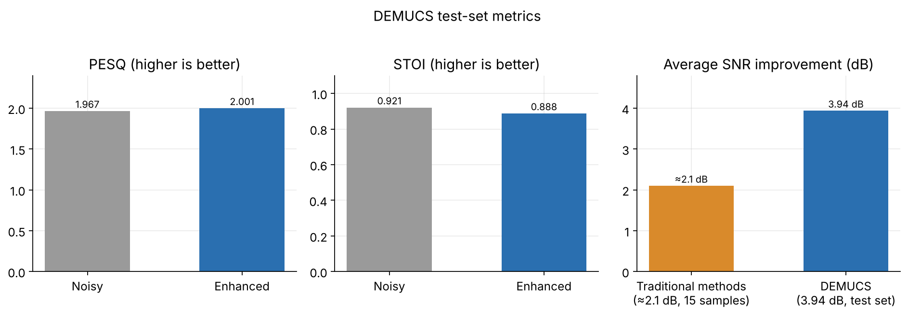
</p>
<p align="center"><sub>The traditional-methods bar is the report's approximate average over 15 samples. DEMUCS is the average over the test set. They aren't the exact same set of audio, so read it as a rough comparison.</sub></p>

Reading this honestly: the SNR gain is clear, but PESQ barely moves and STOI goes **down** a little. In the report we put this down to the model being quite aggressive, so it sometimes removes bits of speech along with the noise. The model cleans up well, but it doesn't make the speech more intelligible on average.

### DEMUCS vs. spectral subtraction, sample by sample

Of the traditional methods we tried, spectral subtraction with 200 frames gave the best results on the samples we compared, so that's the baseline here. Values are the change compared to the noisy input, on six samples.

<p align="center">
  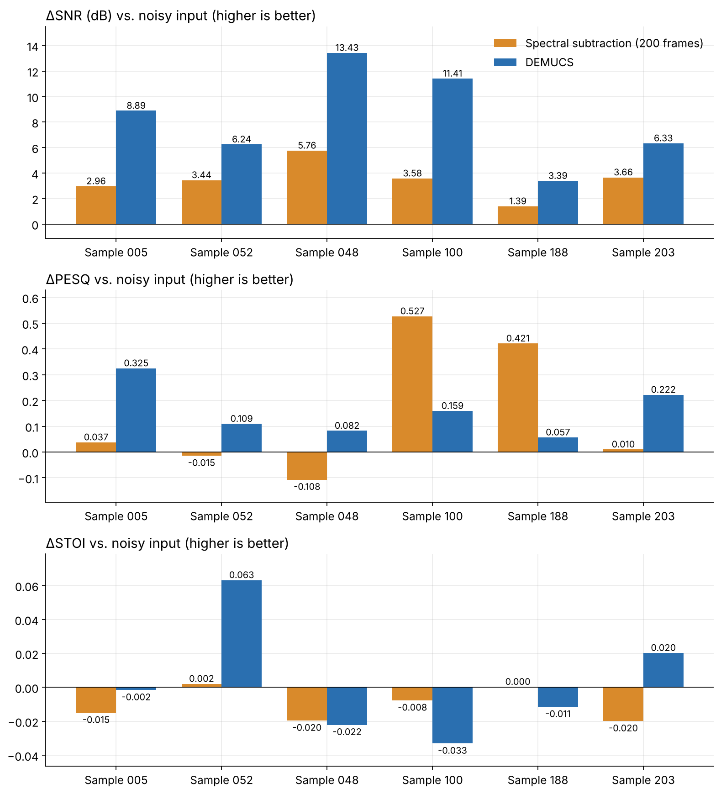
</p>

The same numbers as a table:

| Sample | Method | ΔPESQ | ΔSTOI | ΔSNR (dB) |
|---|---|---|---|---|
| 005 | Spectral subtraction | 0.0375 | −0.0150 | 2.9642 |
| | DEMUCS | 0.3250 | −0.0016 | 8.8890 |
| 052 | Spectral subtraction | −0.0148 | 0.0021 | 3.4432 |
| | DEMUCS | 0.1094 | 0.0632 | 6.2428 |
| 048 | Spectral subtraction | −0.1076 | −0.0196 | 5.7587 |
| | DEMUCS | 0.0824 | −0.0221 | 13.4318 |
| 100 | Spectral subtraction | 0.5271 | −0.0077 | 3.5763 |
| | DEMUCS | 0.1594 | −0.0331 | 11.4093 |
| 188 | Spectral subtraction | 0.4215 | 0.0003 | 1.3947 |
| | DEMUCS | 0.0566 | −0.0115 | 3.3854 |
| 203 | Spectral subtraction | 0.0098 | −0.0199 | 3.6583 |
| | DEMUCS | 0.2223 | 0.0203 | 6.3321 |

DEMUCS has the higher SNR gain on all six samples. PESQ is mixed: DEMUCS is ahead on four samples, but spectral subtraction wins on samples 100 and 188. STOI is mixed too, and both methods lose a little intelligibility on several samples. Six samples is a small comparison, so treat it as a rough picture.

### The traditional methods, in pictures

We implemented four traditional methods. The code for them isn't in this repo, but these are the results from the report. "Sample 1" and "sample 2" here are the two audio samples used in the traditional-methods experiments (sample 2 has crows cawing in the background). They aren't the same as the samples in the table above.

<p align="center">
  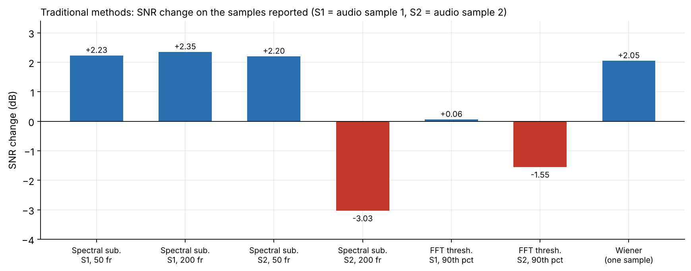
</p>

**Spectral subtraction.** Worked best when noise was steady. The right number of frames depended on the audio: on sample 1, 200 frames did slightly better than 50, but on sample 2, 200 frames made the SNR worse while 50 frames helped.

| Sample 1 | Sample 2 |
|---|---|
| 50 frames: SNR 10.00 → 12.23 dB (+2.23) | 50 frames: +2.20 dB |
| 200 frames: SNR 10.00 → 12.35 dB (+2.35) | 200 frames: SNR 10.00 → 6.97 dB (−3.03) |

<p align="center">
  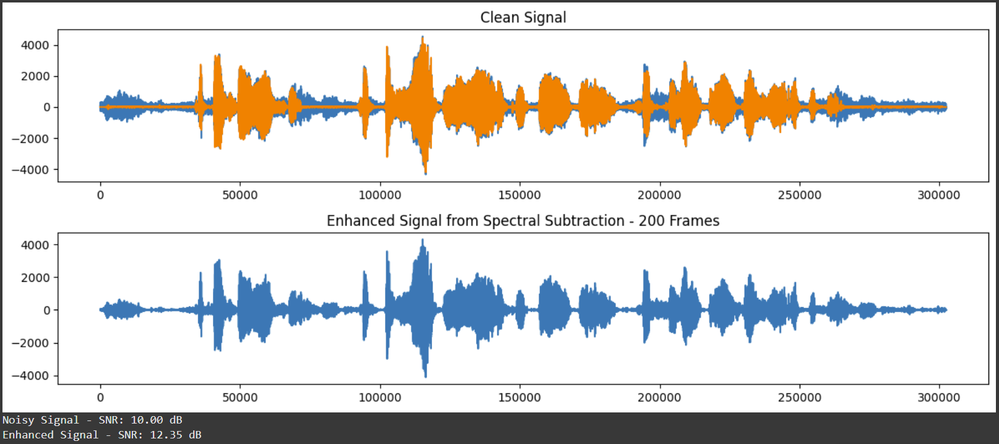
  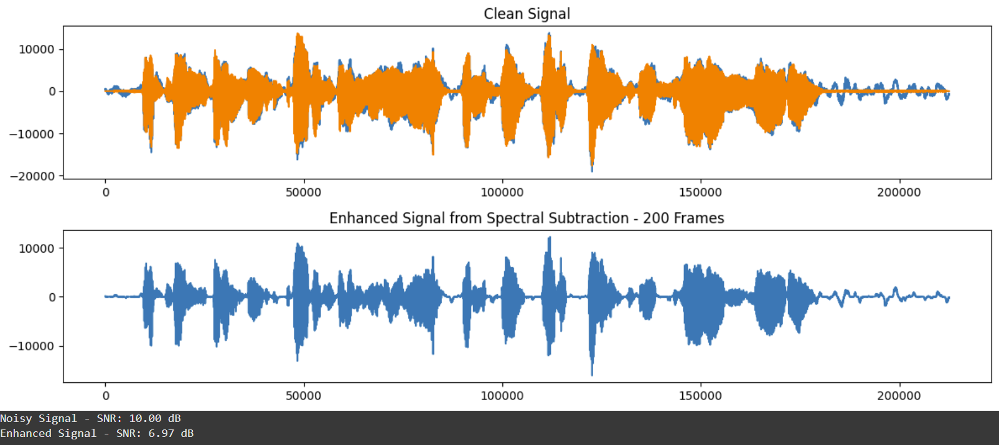
</p>
<p align="center"><sub>Spectral subtraction with 200 frames: sample 1 (left) improved, sample 2 (right) got worse.</sub></p>

<details>
<summary>50-frame versions</summary>

<p align="center">
  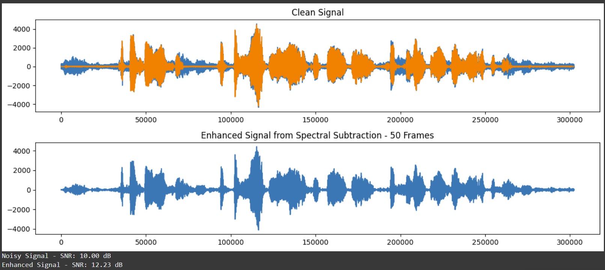
  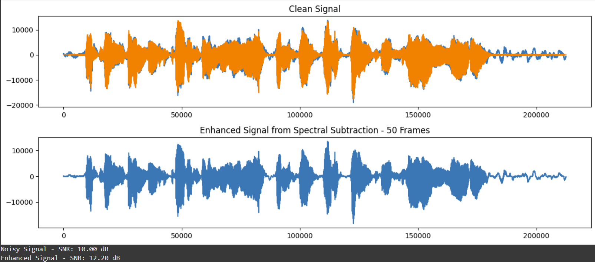
</p>

</details>

**FFT with adaptive thresholding.** Very sensitive to the noise-floor percentile. On sample 1, the 90th percentile gave only +0.06 dB and left audible noise. The 98th removed more noise but added artifacts and lowered SNR. On sample 2, the 90th percentile removed the cawing but added distortion, and SNR dropped by 1.55 dB.

<p align="center">
  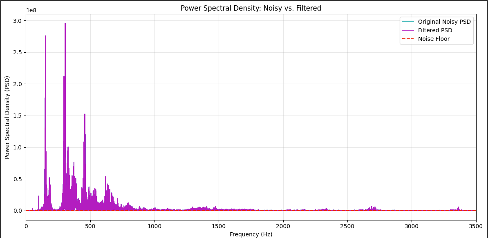
  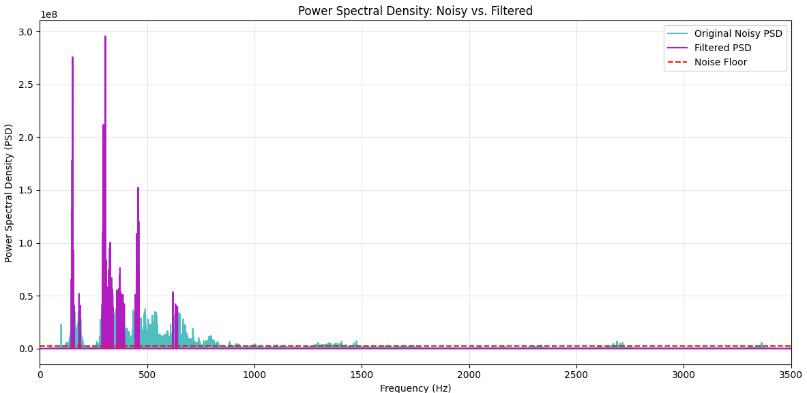
</p>
<p align="center"><sub>Sample 1, noise floor at the 90th percentile (left) and the 98th (right).</sub></p>

<details>
<summary>Time-domain plots and sample 2</summary>

<p align="center">
  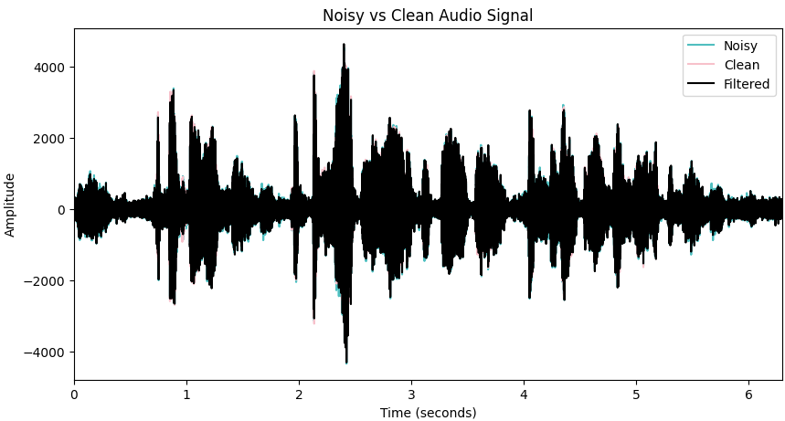
  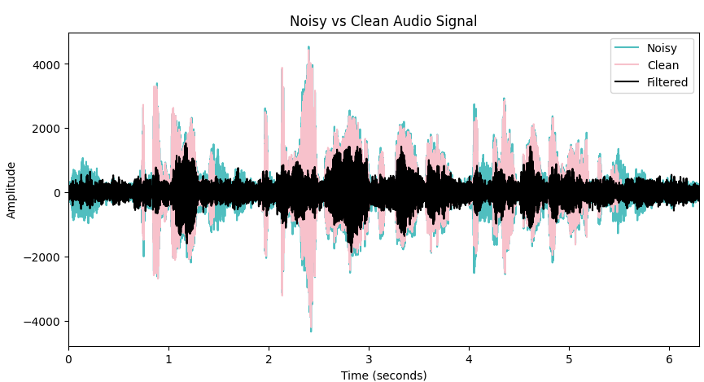
</p>
<p align="center">
  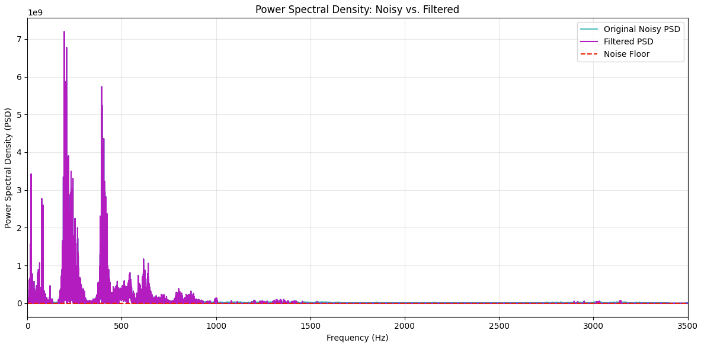
  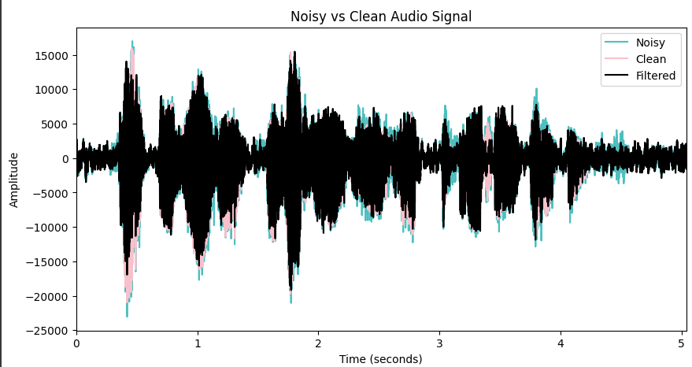
</p>

</details>

**Frequency-domain filtering and peak evaluation.** We first assumed the noise sat in the low frequencies. It didn't: it was spread across the whole spectrum. Keeping the strong spectral peaks worked better than masking a fixed band. We don't have a clean before/after number for this one.

<p align="center">
  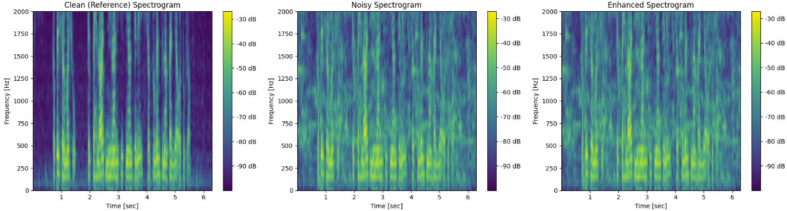
</p>
<p align="center"><sub>Clean, noisy and enhanced spectrograms (report Fig. 4.7, which sits in the peak-evaluation part of the report).</sub></p>

**Wiener filter.** One sample went from 10.0 dB to 12.05 dB SNR (+2.05 dB).

<p align="center">
  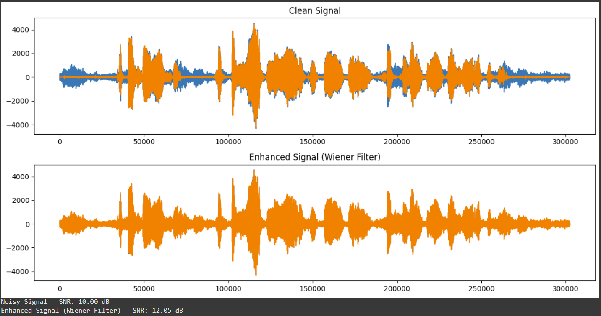
</p>

Across 15 test samples, the traditional methods gave an average SNR gain of roughly 2.1 dB, compared with 3.94 dB for DEMUCS. All of them needed per-sample tuning (frame count, percentile, threshold) to work well.

---

## Where DEMUCS struggled

- **Mildly noisy audio.** When there wasn't much noise to begin with, the model sometimes added small artifacts, like a slight reverb or a warped quality in the voice.
- **Hard cuts between segments.** We trained on 1-second clips with no overlap, so the transitions between clips may be abrupt. This is our best guess for part of the artifacts, though we haven't tested it.
- **Over-suppression.** The model is tuned to remove noise hard, so with little noise present it can take away fine speech detail. This fits with the small drop in STOI.
- **Limited compute.** Training ran on a free Colab CPU. A longer run on better hardware might do better, but we haven't tried it.

We also haven't measured inference speed or latency. The project was motivated by real-time communication systems, but real-time performance wasn't tested, so we're not claiming it.

---

## Running the demo

You'll need Python 3.9 or newer.

```bash
git clone https://github.com/Sanim27/DEMUCS-Audio-Denoising.git
cd DEMUCS-Audio-Denoising

python -m venv venv
source venv/bin/activate        # on Windows: venv\Scripts\activate

pip install -r requirements.txt
streamlit run denoise.py
```

Make sure the checkpoint path in `denoise.py` points to `epoch_75.pth`. A path relative to the script works on any machine:

```python
from pathlib import Path
checkpoint_path = Path(__file__).resolve().parent / "epoch_75.pth"
```

### What the app does

1. You upload a noisy WAV file.
2. It's resampled to 16 kHz and split into 1-second segments.
3. Each segment goes through the model (evaluation mode, no gradients).
4. The enhanced segments are joined back together.
5. You can play the result in the browser or download it as a WAV file.

---

## Ideas for later

- Overlapping segments with smooth blending to remove the clip-boundary artifacts.
- Better handling of low-noise audio so clean speech isn't over-processed.
- More training data and a wider range of noise types.
- A hybrid setup where a light post-processing step cleans up what the network leaves behind.
- Measuring latency, and checking whether it can run in real time on modest hardware.

---

## Project info

**Title:** Traditional Filters and AI for Enhanced Signal De-noising
**Institution:** Tribhuvan University, Institute of Engineering, Pulchowk Campus
**Department:** Electronics and Computer Engineering
**Submitted:** April 18, 2025

## References

- A. Défossez, G. Synnaeve, Y. Adi. *Real Time Speech Enhancement in the Waveform Domain.* Facebook AI Research, INRIA, PSL Research University.
- S. Pascual, A. Bonafonte, J. Serrà. *SEGAN: Speech Enhancement Generative Adversarial Network.*
- R. Yamamoto et al. *Parallel WaveGAN* (source of the multi-resolution STFT loss), 2019.
- S. Hochreiter, J. Schmidhuber. *Long Short-Term Memory.* Neural Computation, 9(8), 1997.
- Valentini-Botinhao noisy speech dataset.
